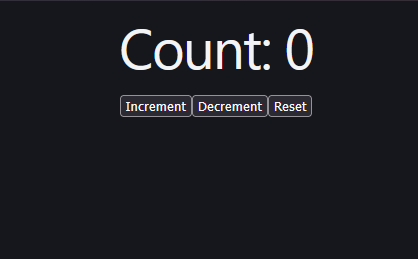
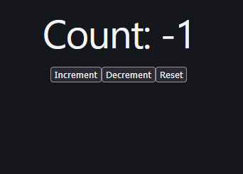
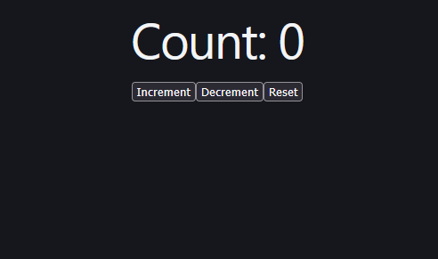
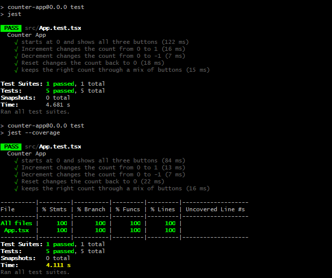

## Step 1: Exploratory Testing

Unlike the North Vacation booking app test plan in recent weeks, the tests were practically written before they were even ran. Exploratory testing, however, is the opposite and you learn more about the software and test it at the same time. Every time you experiment with something, you get more ideas on what to try next.

### Making a test charter

Keeping a charter makes sure that you aren't aimlessly testing, but focused on completing a "mission" statement or goal for each testing session. From the beginning, narrow down what part of the app to test, how you will test it, and what you're trying to find out. You can time these sessions or set specific goals.

Explore: the counter app's Increment, Decrement, and Reset buttons With: clicking the buttons in different orders, clicking fast, the keyboard, and refreshing the page To discover: if the app remembers what count I had after a refresh

Tools: The Counter application, Jest, React Testing Library, a text editor, Git, and GitHub.

Time box: 20 minutes

|Action|Expected Result|Actual Result|Pass or Fail|
|---|---|---|---|
|Load the page|Count starts at 0|Count: 0, with Increment, Decrement, and Reset buttons|Pass|
|Select Decrement once, then refresh the page|Count goes to -1 and is still -1 after the refresh, saved in the browser|Count went to -1, but after the refresh it went back to 0|Fail|
|Select Decrement 3 times, then Reset|Count goes to -3, then Reset brings it back to 0|Count went -1, -2, -3, then back to 0|Pass|
|Select Reset when the count is already 0|Nothing changes and no error shows|Count stayed at 0 and nothing else happened|Pass|
|Click Increment as fast as I can 20 times|Count ends at 20, matching my clicks|Count ended at 20|Pass|
|Increment 2 times, Decrement once, Reset, then Increment once|Count goes 1, 2, 1, 0, 1 and the buttons still work after Reset|Count went 1, 2, 1, 0, 1|Pass|
|Tab to the Increment button and press Enter, then Space|Count goes up by 1 each time, same as clicking|Count went to 1, then 2|Pass|

The app also lets the count go below 0. Nothing on the page says if negative numbers are allowed, so I couldn't tell if that was on purpose just from using it.

Results of some of the initial tests:

Count Loaded:








## Step 2: Reviewing the source code

Refreshing resets the count, so the app doesn't save anything in the browser. This failed my expectation, but there's no requirement that says it should save. So it might not be a bug, just something I assumed. Without looking at the code, I could already guess there probably isn't any persistent storage logic.

Screenshots for the starting test are included in this repo inside of /screenshots. Moving onto opening the code itself, we can do a walkthrough of the behavior.

In /src/App.tsx:

```tsx
const [count, setCount] = useState(0);
```

The current number starts at 0 and setCount can change that number. useState is the React tool that remembers that value. Every time setCount runs, it tells React to save the new number and run App() again, and then the page displays it.

The starting value is 0. useState(0) creates a piece of state called count and starts it at 0. count is just the number, not a function. setCount is the only way to change it. Whenever setCount runs, React redraws the page with the new number displayed.

|Statement|User action that runs it|What it does|
|---|---|---|
|setCount(count + 1)|Select Increment|Adds 1 to the count|
|setCount(count - 1)|Select Decrement|Subtracts 1 from the count|
|setCount(0)|Select Reset|Sets the count back to 0|

Each button has an onClick and that code ONLY runs when you click that button. White box testing means you can see there are exactly three statements that change the count, so you know your tests need to cover all three. We will write one test per statement.

No branches and loops in this example, as there aren't any decisions being made. The count React component is not making a decision or testing true/false. It is only subtracting when it decrements and adding when it increments. No decisions means there isn't any branch coverage to apply and there aren't loops since nothing is repeating. If we changed decrement to `if (count > 0) setCount(count - 1)` then we would need branch coverage, with one test where the condition is true (count is above 0, so it subtracts) and one where it's false (count is 0, so nothing happens).

This also explains what I found in Step 1. The count resets on refresh because useState only keeps the value in memory while the page is open, and there's no localStorage code saving it. The count can go negative because there's no if statement stopping Decrement at 0.

## Step 3: Setting Up and Running the test file

```
npm install -D jest ts-jest @types/jest jest-environment-jsdom @testing-library/react @testing-library/dom @testing-library/jest-dom
```

Setting up dependency packages, in this case using Jest, TypeScript, React Testing Library to use their tools, having the jest-dom to read and check for content, etc.

Test script:

```
npm pkg set scripts.test="jest"
```

jest.config.cjs added into the counter-app folder:

```
module.exports = {
  testEnvironment: "jsdom",
  transform: {
    "^.+\\.tsx?$": ["ts-jest", { tsconfig: { jsx: "react-jsx", esModuleInterop: true, types: ["jest", "@testing-library/jest-dom"] } }],
  },
  setupFilesAfterEnv: ["@testing-library/jest-dom"],
};
```

Setting the testEnvironment to jsdom gives the tests a fake browser, so React has a page to draw on without opening Firefox. The file has to end in .cjs because the project's package.json has "type": "module", the same problem I ran into in LP01.

I also added "jest" and "@testing-library/jest-dom" to the types in tsconfig.app.json so VS Code would stop underlining describe, test, and expect.

The tests are in src/App.test.tsx inside one describe block called "Counter App". They use render to draw the app, screen to find the heading and buttons, fireEvent to click the buttons, and expect to check the count.

## Step 4: Test the Starting State

```tsx
test("starts at 0 and shows all three buttons", () => {
  render(<App />);

  expect(screen.getByText("Count: 0")).toBeInTheDocument();
  expect(screen.getByRole("button", { name: "Increment" })).toBeInTheDocument();
  expect(screen.getByRole("button", { name: "Decrement" })).toBeInTheDocument();
  expect(screen.getByRole("button", { name: "Reset" })).toBeInTheDocument();
});
```

This test doesn't click anything. It just checks what useState(0) sets up before the user does anything, which is the same thing as my first row in Step 1. I found the buttons by their role and name, the same way a screen reader sees the page, so if someone renamed a button this test would catch it.

## Step 5: Test Statement Coverage

One test for each statement that changes the count:

```tsx
test("Increment changes the count from 0 to 1", () => {
  render(<App />);

  fireEvent.click(screen.getByRole("button", { name: "Increment" }));

  expect(screen.getByText("Count: 1")).toBeInTheDocument();
});

test("Decrement changes the count from 0 to -1", () => {
  render(<App />);

  fireEvent.click(screen.getByRole("button", { name: "Decrement" }));

  expect(screen.getByText("Count: -1")).toBeInTheDocument();
});

test("Reset changes the count back to 0", () => {
  render(<App />);

  fireEvent.click(screen.getByRole("button", { name: "Increment" }));
  fireEvent.click(screen.getByRole("button", { name: "Increment" }));
  expect(screen.getByText("Count: 2")).toBeInTheDocument();

  fireEvent.click(screen.getByRole("button", { name: "Reset" }));

  expect(screen.getByText("Count: 0")).toBeInTheDocument();
});
```

The Reset test has to move the count away from 0 first. If it just clicked Reset on a fresh page, the count would already be 0 and the test would pass even if Reset did nothing at all. I also check that it actually got to 2 before resetting, so I know the setup worked.

## Step 6: Test a Sequence of Actions

```tsx
test("keeps the right count through a mix of buttons", () => {
  render(<App />);
  const increment = screen.getByRole("button", { name: "Increment" });
  const decrement = screen.getByRole("button", { name: "Decrement" });
  const reset = screen.getByRole("button", { name: "Reset" });

  fireEvent.click(increment);
  fireEvent.click(increment);
  fireEvent.click(increment);
  expect(screen.getByText("Count: 3")).toBeInTheDocument();

  fireEvent.click(decrement);
  expect(screen.getByText("Count: 2")).toBeInTheDocument();

  fireEvent.click(reset);
  expect(screen.getByText("Count: 0")).toBeInTheDocument();

  fireEvent.click(decrement);
  fireEvent.click(decrement);
  expect(screen.getByText("Count: -2")).toBeInTheDocument();
});
```

This one is closer to how a real person uses the app. It goes up, down, resets, and then keeps going after the reset into negative numbers. I check the count after each part so if it fails, I know which step broke instead of just knowing the end number was wrong.

## Step 7: Run the Tests

```
npm test
```

All 5 tests passed.

## Step 8: Review Code Coverage

```
npm test -- --coverage
```

|Coverage Type|Percentage|
|---|---|
|Statements|100%|
|Branches|100%|
|Functions|100%|
|Lines|100%|
SCREENSHOT OF RESULTS:
(top) test suites, (bottom) code coverage





My tests ran every part of App.tsx: the useState line, the return that draws the page, and all three onClick functions. No statements were left untested. Functions shows 4 instead of 3 because App itself counts as a function along with the three arrow functions in the buttons.

Branches says 100%, but there are actually 0 branches. Jest counts 0 out of 0 as 100%, so the number looks good but it isn't measuring anything here. That matches what I found in Step 2, since there's no if, ternary, or && in the component.

I don't think 100% proves the component works correctly. Coverage only tells me each line ran at least once, not that it did the right thing. If Increment was written as count + 2, it would still be 100% covered and only my expect lines would catch it. Coverage also can't tell me about things that aren't in the code at all, like the count not saving after a refresh.

## Step 9: Compare the Two Approaches

One test idea I got from exploratory testing was refreshing the page to see if the count was saved. I would never have thought to write that as a Jest test because there's no code for it, so nothing in the source would point me there.

One test idea I got from reading the code was the Reset test needing to start away from 0. Once I saw Reset is just setCount(0), I realized testing it from 0 would prove nothing.

Viewing the code changed my testing because I stopped guessing. In Step 1 I couldn't tell if negative numbers were on purpose, but in Step 2 I could see there's simply no check for it. It also told me exactly how many things needed tests (three statements), so I knew when I was done.

A limitation of exploratory testing is that it depends on what I think to try, and it's hard to repeat exactly the same way. Clicking "as fast as I can" isn't the same every time. A limitation of white box testing is that it only tests what's in the code. It can reach 100% coverage and still miss a feature that was never written, like saving the count.

Running the app on my own computer also found problems that weren't in App.tsx at all. The starter's package.json had a Linux-only package that broke npm install on Windows, Firefox couldn't connect to localhost until I used 127.0.0.1, and installing packages from the wrong folder gave me two copies of React, which made useState come back as null. None of those would show up from just reading the component.

Personal Note: Exploratory testing felt more like how I'd actually use an app, and white box testing felt more like a checklist to make sure I didn't skip anything. Doing both caught things the other one couldn't.
